<p align="center">
  <a href="https://nextui.dev">
    <picture>
      <source media="(prefers-color-scheme: dark)" srcset=".github/assets/logo-dark.svg" />
      
    </picture>
  </a>
</p>

<h1 align="center">nextui</h1>

<p align="center">Agent UI components for React &amp; Tailwind: chat streaming, artifacts and agent workflows.<br />Free, open source, install with one command.</p>

<p align="center"><a href="https://nextui.dev"><b>Browse the library →</b></a></p>

- 73 components, blocks and pages for AI apps and the product around them
- One command to set up, then install any item by name: the code lands in your project, no package to depend on
- Works with your coding agent over MCP, plus an agent skill for Claude Code, Cursor, Codex and others

## Quick start

In a React + Tailwind project, run:

```bash
npm create nextui
```

It opens nextui.dev in your browser so you can approve the sign-in, then:

1. saves an access key for this machine to `.env.local` as `NEXTUI_TOKEN` (and keeps `.env.local` out of git),
2. adds the `@nextui` registry to `components.json` (no `components.json` yet? it runs `npx shadcn@latest init` first),
3. connects your AI agent over MCP if you pick one: Claude Code, Cursor, VS Code or Codex.

Starting from scratch? [New project](https://nextui.dev/docs/new-project) walks through Next.js and Vite.

## Install an item

```bash
npm create nextui add agent-chat
```

Pass several names at once, or use the shadcn CLI directly: `npx shadcn@latest add @nextui/agent-chat`. Every item's page on [nextui.dev](https://nextui.dev) has a live preview and its install command.

Options for setup: `--client claude|cursor|vscode|codex` skips the question and `--no-mcp` skips MCP. With npm, put them after `--`: `npm create nextui -- --client claude`. It also works as `pnpm create nextui`, `yarn create nextui` and `bun create nextui`.

### Accounts and keys

- A free account gets **3 copies or installs a day**. [Builder](https://nextui.dev/pricing) removes the limit.
- Each machine gets its own access key. See and revoke them at [Account → API keys](https://nextui.dev/account/api-keys).

## Use it with your coding agent

Pick your client when `npm create nextui` asks and it connects the shadcn MCP server, so your agent can list, search and install `@nextui` items for you. Name `@nextui` in the prompt, for example "add the @nextui agent-chat to the chat page". Setup for each client is in the [MCP docs](https://nextui.dev/docs/mcp).

You can also add the agent skill:

```bash
npx skills add tini-coder/nextui
```

Then ask for what you want, for example "add an agent chat that streams its answer". The skill lives in [`skills/nextui/`](skills/nextui/SKILL.md).

## Agent UI

<table>
<tr><td width="50%" valign="top"><a href="https://nextui.dev/blocks/agent-chat">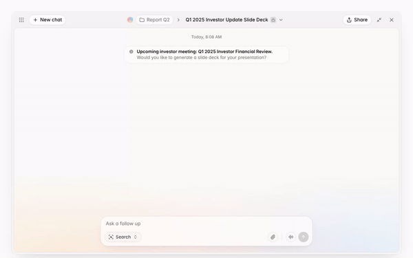</a><br /><a href="https://nextui.dev/blocks/agent-chat"><b>Agent chat</b></a> · <code>agent-chat</code><sub></sub><br /><sub>AI assistant thread in an app window that types a request, thinks over a sparkle field, asks a follow-up with a select and choice tiles, then streams its answer word by word.</sub></td><td width="50%" valign="top"><a href="https://nextui.dev/components/chat-input">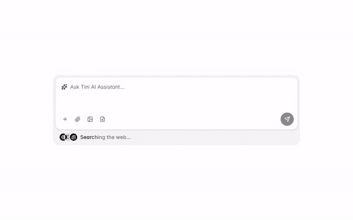</a><br /><a href="https://nextui.dev/components/chat-input"><b>Chat input</b></a> · <code>chat-input</code><sub></sub><br /><sub>Rounded AI prompt box with attach tools, a round send button and a shimmering "Searching the web" status below.</sub></td></tr>
<tr><td width="50%" valign="top"><a href="https://nextui.dev/components/voice-agent">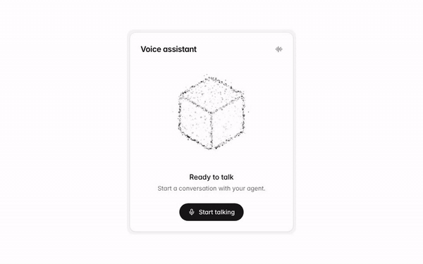</a><br /><a href="https://nextui.dev/components/voice-agent"><b>Voice agent</b></a> · <code>voice-agent</code><sub></sub><br /><sub>Voice assistant card with a cube outline made of particles that shake like sound while the call is live, and a Start talking / End call button.</sub></td><td width="50%" valign="top"><a href="https://nextui.dev/components/voice-orb"></a><br /><a href="https://nextui.dev/components/voice-orb"><b>Voice orb</b></a> · <code>voice-orb</code><sub></sub><br /><sub>Voice assistant card with a swirling sphere of particles, each with its own speed and size, that surge out from the centre and back while the call is live, and a Start talking / End call button.</sub></td></tr>
<tr><td width="50%" valign="top"><a href="https://nextui.dev/components/task-checklist">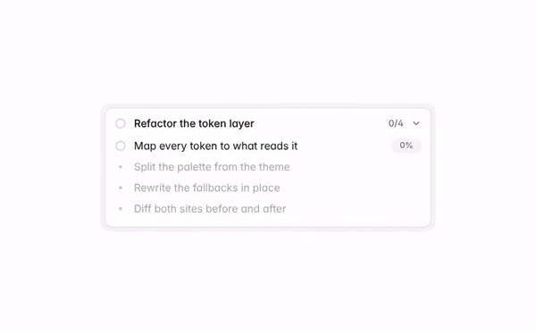</a><br /><a href="https://nextui.dev/components/task-checklist"><b>Task checklist</b></a> · <code>task-checklist</code><sub></sub><br /><sub>Collapsible to-do list for an AI agent: each step fills a progress ring, rolls its percentage and strikes through when done.</sub></td><td width="50%" valign="top"><a href="https://nextui.dev/components/thinking-wave">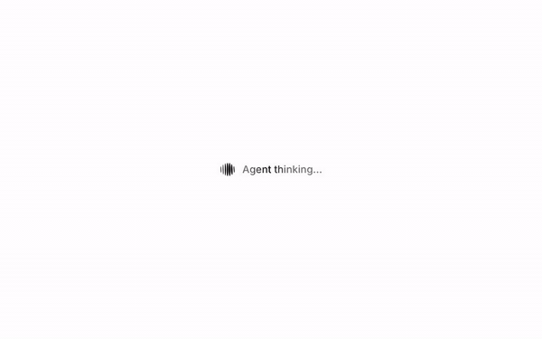</a><br /><a href="https://nextui.dev/components/thinking-wave"><b>Thinking wave</b></a> · <code>thinking-wave</code><sub></sub><br /><sub>Thinking indicator: a breathing wave orb and a shimmering label.</sub></td></tr>
</table>

## Components

<table>
<tr><td width="50%" valign="top"><a href="https://nextui.dev/components/thinking-ring"></a><br /><a href="https://nextui.dev/components/thinking-ring"><b>Thinking ring</b></a> · <code>thinking-ring</code><sub> · source in this repo</sub><br /><sub>Thinking indicator: a wobbling dot ring and a shimmering label.</sub></td><td width="50%" valign="top"><a href="https://nextui.dev/components/thinking-sparkle"></a><br /><a href="https://nextui.dev/components/thinking-sparkle"><b>Thinking sparkle</b></a> · <code>thinking-sparkle</code><sub> · source in this repo</sub><br /><sub>AI thinking status with a monochrome sparkling diamond and shimmering text.</sub></td></tr>
<tr><td width="50%" valign="top"><a href="https://nextui.dev/components/thinking-bot"></a><br /><a href="https://nextui.dev/components/thinking-bot"><b>Thinking bot</b></a> · <code>thinking-bot</code><sub> · source in this repo</sub><br /><sub>AI thinking status with a sleek android helmet whose visor bars bounce like a voice meter beside shimmering text.</sub></td><td width="50%" valign="top"><a href="https://nextui.dev/components/prompt-deck"></a><br /><a href="https://nextui.dev/components/prompt-deck"><b>Prompt deck</b></a> · <code>prompt-deck</code><sub> · source in this repo</sub><br /><sub>A stack of prompt cards that swipes the front card away and lifts the next one into place, on a loop while it is on screen.</sub></td></tr>
<tr><td width="50%" valign="top"><a href="https://nextui.dev/components/labeled-input"></a><br /><a href="https://nextui.dev/components/labeled-input"><b>Labeled input</b></a> · <code>labeled-input</code><sub> · source in this repo</sub><br /><sub>Email input with a label and helper text.</sub></td><td width="50%" valign="top"><a href="https://nextui.dev/components/subscribe-input"></a><br /><a href="https://nextui.dev/components/subscribe-input"><b>Subscribe input</b></a> · <code>subscribe-input</code><sub> · source in this repo</sub><br /><sub>Newsletter-style input with a leading icon and submit button.</sub></td></tr>
<tr><td width="50%" valign="top"><a href="https://nextui.dev/components/settings-list"></a><br /><a href="https://nextui.dev/components/settings-list"><b>Settings list</b></a> · <code>settings-list</code><sub> · source in this repo</sub><br /><sub>Notification settings list with switches.</sub></td><td width="50%" valign="top"><a href="https://nextui.dev/components/password-input"></a><br /><a href="https://nextui.dev/components/password-input"><b>Password input</b></a> · <code>password-input</code><sub> · source in this repo</sub><br /><sub>Password input with show/hide toggle and a live strength checklist.</sub></td></tr>
<tr><td width="50%" valign="top"><a href="https://nextui.dev/components/otp-input"></a><br /><a href="https://nextui.dev/components/otp-input"><b>OTP input</b></a> · <code>otp-input</code><sub> · source in this repo</sub><br /><sub>Six-digit OTP input with paste, backspace and arrow-key support.</sub></td><td width="50%" valign="top"><a href="https://nextui.dev/components/waitlist"></a><br /><a href="https://nextui.dev/components/waitlist"><b>Waitlist</b></a> · <code>waitlist</code><sub> · source in this repo</sub><br /><sub>Email signup with a live avatar stack: new people slide in, the last one tucks under a rolling join counter.</sub></td></tr>
<tr><td width="50%" valign="top"><a href="https://nextui.dev/components/dropzone">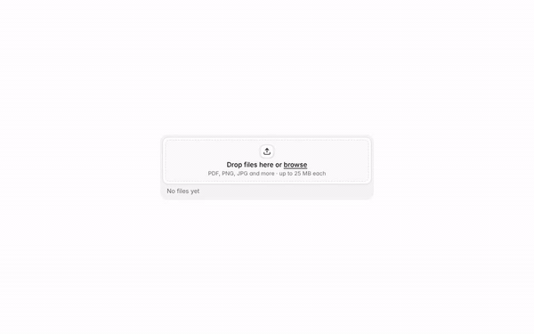</a><br /><a href="https://nextui.dev/components/dropzone"><b>Dropzone</b></a> · <code>dropzone</code><sub></sub><br /><sub>Drop zone that grows as files land, with per-file progress, errors and retry.</sub></td><td width="50%" valign="top"><a href="https://nextui.dev/components/contact-stack">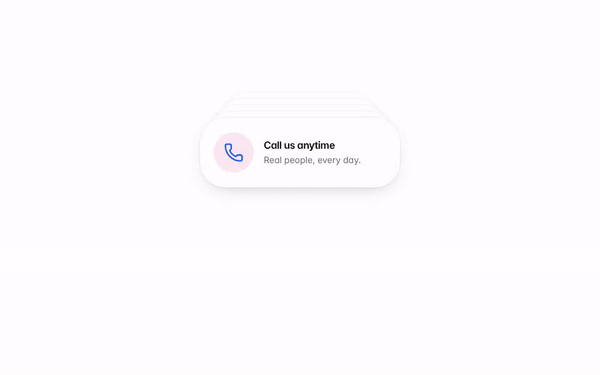</a><br /><a href="https://nextui.dev/components/contact-stack"><b>Contact stack</b></a> · <code>contact-stack</code><sub></sub><br /><sub>A stack of contact cards with pastel icon circles: the front card drops away and tucks behind the rest, on a loop while it is on screen.</sub></td></tr>
<tr><td width="50%" valign="top"><a href="https://nextui.dev/components/service-receipt">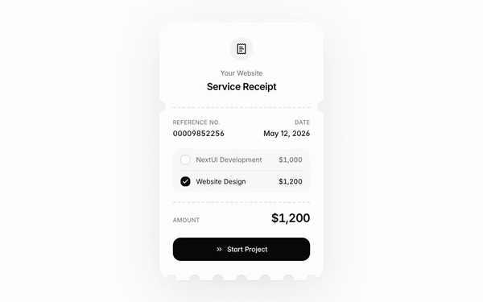</a><br /><a href="https://nextui.dev/components/service-receipt"><b>Service receipt</b></a> · <code>service-receipt</code><sub></sub><br /><sub>A light ticket-style receipt with notched edges, dashed tear lines and a scalloped bottom: tick service lines and the amount adds up before starting the project.</sub></td><td width="50%" valign="top"><a href="https://nextui.dev/components/revenue-card">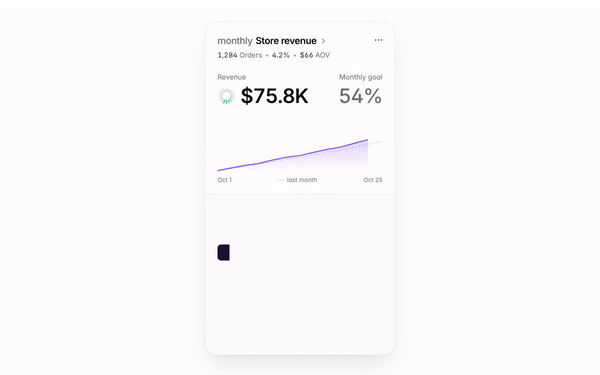</a><br /><a href="https://nextui.dev/components/revenue-card"><b>Revenue card</b></a> · <code>revenue-card</code><sub></sub><br /><sub>A light analytics card for monthly revenue: stat numbers count up as a month-to-date chart draws in, with a goal share, a trend versus last month and a hatched channel bar with a dot legend.</sub></td></tr>
<tr><td width="50%" valign="top"><a href="https://nextui.dev/components/swipe-deck">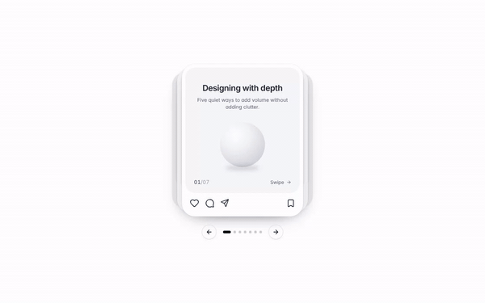</a><br /><a href="https://nextui.dev/components/swipe-deck"><b>Swipe deck</b></a> · <code>swipe-deck</code><sub></sub><br /><sub>A deck of soft social carousel posts with an inner panel, a visual, a page index and a like, comment, share and bookmark row: the front card swings out to the left as the next one steps up, by timer, swipe or arrows.</sub></td><td width="50%" valign="top"><a href="https://nextui.dev/components/story-testimonial">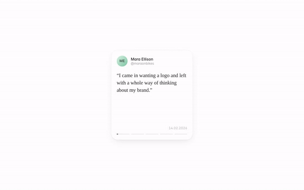</a><br /><a href="https://nextui.dev/components/story-testimonial"><b>Story testimonial</b></a> · <code>story-testimonial</code><sub></sub><br /><sub>A white testimonial card with an avatar, name, handle, serif quote and date that plays like a story: the active bar along the bottom fills, then the next quote fades in. Tap either side to step back or forward.</sub></td></tr>
<tr><td width="50%" valign="top"><a href="https://nextui.dev/components/marquee-card">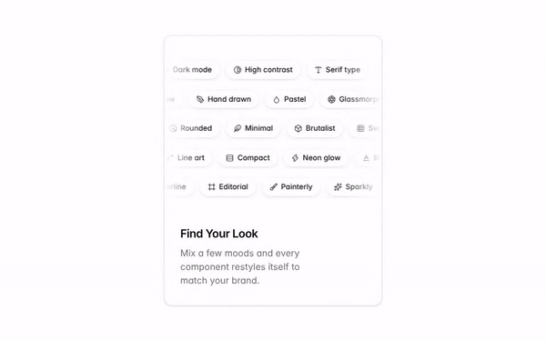</a><br /><a href="https://nextui.dev/components/marquee-card"><b>Marquee card</b></a> · <code>marquee-card</code><sub></sub><br /><sub>Feature card with rows of style tags drifting in alternating directions behind faded edges, above a short headline.</sub></td><td width="50%" valign="top"><a href="https://nextui.dev/components/animated-metrics-card">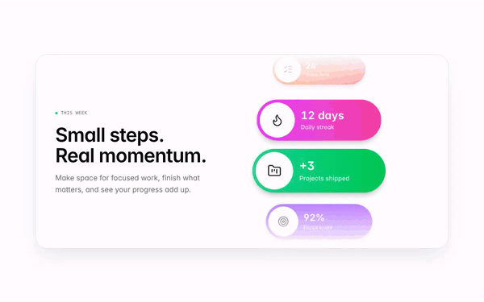</a><br /><a href="https://nextui.dev/components/animated-metrics-card"><b>Animated metrics card</b></a> · <code>animated-metrics-card</code><sub></sub><br /><sub>A weekly productivity card with colorful deep-work, task, streak and project metrics scrolling in a seamless loop.</sub></td></tr>
<tr><td width="50%" valign="top"><a href="https://nextui.dev/components/folder-card"></a><br /><a href="https://nextui.dev/components/folder-card"><b>Folder card</b></a> · <code>folder-card</code><sub> · source in this repo</sub><br /><sub>Folder that opens on hover and fans out the files inside.</sub></td><td width="50%" valign="top"><a href="https://nextui.dev/components/celebration-card">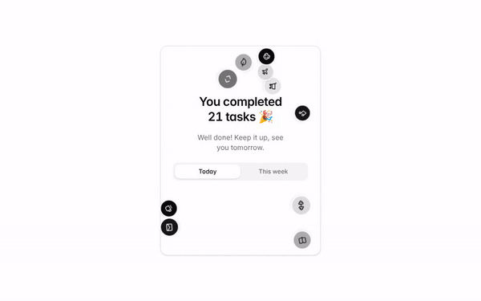</a><br /><a href="https://nextui.dev/components/celebration-card"><b>Celebration card</b></a> · <code>celebration-card</code><sub></sub><br /><sub>Task bubbles rain down, pile up on the headline and drain away when you switch range.</sub></td></tr>
<tr><td width="50%" valign="top"><a href="https://nextui.dev/components/pdf-stack"></a><br /><a href="https://nextui.dev/components/pdf-stack"><b>PDF stack</b></a> · <code>pdf-stack</code><sub> · source in this repo</sub><br /><sub>A file card with paper sheets and tilted profile cards behind it that rise in on enter and fan out on hover.</sub></td><td width="50%" valign="top"><a href="https://nextui.dev/components/waitlist-pass"></a><br /><a href="https://nextui.dev/components/waitlist-pass"><b>Waitlist pass</b></a> · <code>waitlist-pass</code><sub> · source in this repo</sub><br /><sub>Ticket-style waitlist pass with notched edges, a QR code stub and a tilt-and-glare hover.</sub></td></tr>
<tr><td width="50%" valign="top"><a href="https://nextui.dev/components/globe-arcs">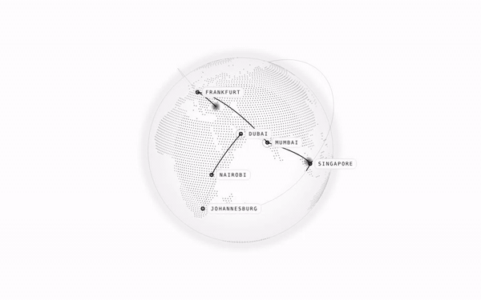</a><br /><a href="https://nextui.dev/components/globe-arcs"><b>Globe arcs</b></a> · <code>globe-arcs</code><sub></sub><br /><sub>A dotted globe with arcs that draw between cities; drag to turn it, or click a city to bring it to the front.</sub></td><td width="50%" valign="top"><a href="https://nextui.dev/components/sleep-bars">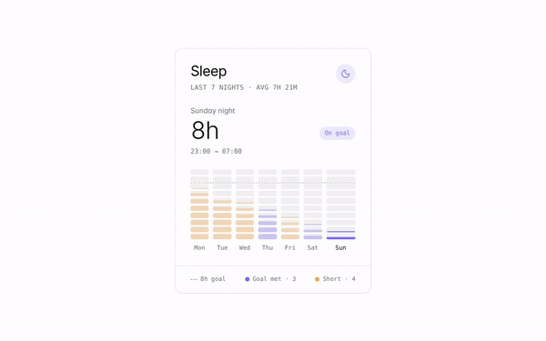</a><br /><a href="https://nextui.dev/components/sleep-bars"><b>Sleep bars</b></a> · <code>sleep-bars</code><sub></sub><br /><sub>A week of sleep as columns of lights, one light per hour, with a dashed goal line. Click or arrow through the nights to pick one and see its hours, bedtime and how far it sits from the goal.</sub></td></tr>
<tr><td width="50%" valign="top"><a href="https://nextui.dev/components/icon-buttons"></a><br /><a href="https://nextui.dev/components/icon-buttons"><b>Icon buttons</b></a> · <code>icon-buttons</code><sub> · source in this repo</sub><br /><sub>Secondary, outline and destructive buttons with soft status buttons and animated icons, popping in as one group.</sub></td><td width="50%" valign="top"><a href="https://nextui.dev/components/qr-badge"></a><br /><a href="https://nextui.dev/components/qr-badge"><b>QR badge</b></a> · <code>qr-badge</code><sub> · source in this repo</sub><br /><sub>A QR code that dissolves into sand, pours into a scan badge and grows back.</sub></td></tr>
<tr><td width="50%" valign="top"><a href="https://nextui.dev/components/avatar-group"></a><br /><a href="https://nextui.dev/components/avatar-group"><b>Avatar group</b></a> · <code>avatar-group</code><sub> · source in this repo</sub><br /><sub>Stacked avatars with an overflow count.</sub></td><td width="50%" valign="top"><a href="https://nextui.dev/components/price-badge"></a><br /><a href="https://nextui.dev/components/price-badge"><b>Price badge</b></a> · <code>price-badge</code><sub> · source in this repo</sub><br /><sub>Pill badge that rolls between prices glyph by glyph, resizing smoothly as it goes.</sub></td></tr>
<tr><td width="50%" valign="top"><a href="https://nextui.dev/components/flip-clock">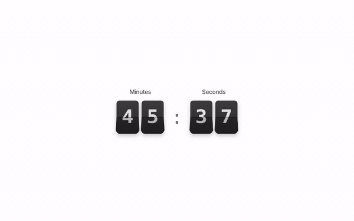</a><br /><a href="https://nextui.dev/components/flip-clock"><b>Flip clock</b></a> · <code>flip-clock</code><sub></sub><br /><sub>A grain-textured dark minutes-and-seconds flip clock with a split-flap fold animation that shows local time or counts down to a target date.</sub></td><td width="50%" valign="top"><a href="https://nextui.dev/components/heart-rate-card">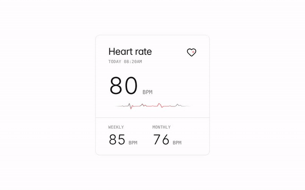</a><br /><a href="https://nextui.dev/components/heart-rate-card"><b>Heart rate card</b></a> · <code>heart-rate-card</code><sub></sub><br /><sub>Minimal heart-rate summary with a segmented range indicator and weekly and monthly averages.</sub></td></tr>
<tr><td width="50%" valign="top"><a href="https://nextui.dev/components/avatar-status"></a><br /><a href="https://nextui.dev/components/avatar-status"><b>Avatar status</b></a> · <code>avatar-status</code><sub> · source in this repo</sub><br /><sub>Team list with online, away and offline status dots.</sub></td><td width="50%" valign="top"><a href="https://nextui.dev/components/sale-stamp">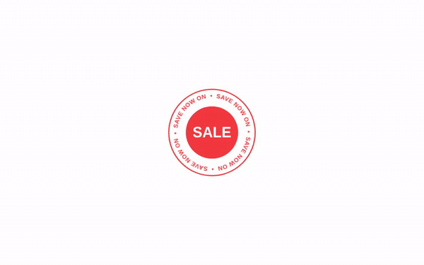</a><br /><a href="https://nextui.dev/components/sale-stamp"><b>Sale stamp</b></a> · <code>sale-stamp</code><sub></sub><br /><sub>A red sale seal with orbiting promotional text and a fixed center label.</sub></td></tr>
<tr><td width="50%" valign="top"><a href="https://nextui.dev/components/alerts"></a><br /><a href="https://nextui.dev/components/alerts"><b>Alerts</b></a> · <code>alerts</code><sub> · source in this repo</sub><br /><sub>Info, success, warning and error alerts with dismiss buttons.</sub></td><td width="50%" valign="top"><a href="https://nextui.dev/components/faq"></a><br /><a href="https://nextui.dev/components/faq"><b>FAQ</b></a> · <code>faq</code><sub> · source in this repo</sub><br /><sub>Accessible accordion built on details and summary.</sub></td></tr>
<tr><td width="50%" valign="top"><a href="https://nextui.dev/components/shortcuts"></a><br /><a href="https://nextui.dev/components/shortcuts"><b>Shortcuts</b></a> · <code>shortcuts</code><sub> · source in this repo</sub><br /><sub>Shortcut list with styled key caps.</sub></td><td width="50%" valign="top"><a href="https://nextui.dev/components/empty-state"></a><br /><a href="https://nextui.dev/components/empty-state"><b>Empty state</b></a> · <code>empty-state</code><sub> · source in this repo</sub><br /><sub>Dashed empty state with a skeleton-card illustration, copy and two actions.</sub></td></tr>
<tr><td width="50%" valign="top"><a href="https://nextui.dev/components/text-reveal">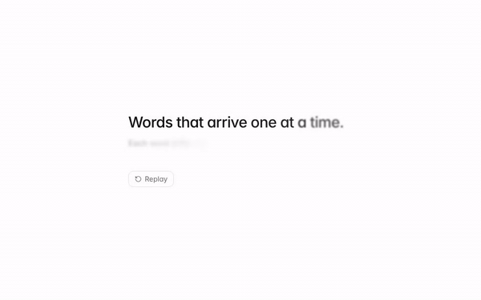</a><br /><a href="https://nextui.dev/components/text-reveal"><b>Text reveal</b></a> · <code>text-reveal</code><sub></sub><br /><sub>Words that arrive one at a time, fading in out of a soft blur as they rise into place.</sub></td><td width="50%" valign="top"><a href="https://nextui.dev/components/sound-ring"></a><br /><a href="https://nextui.dev/components/sound-ring"><b>Sound ring</b></a> · <code>sound-ring</code><sub> · source in this repo</sub><br /><sub>A ring of rounded bars that jumps like an audio visualizer, each beat lifting a cluster of bars into a peak.</sub></td></tr>
<tr><td width="50%" valign="top"><a href="https://nextui.dev/components/perspective-text-swap">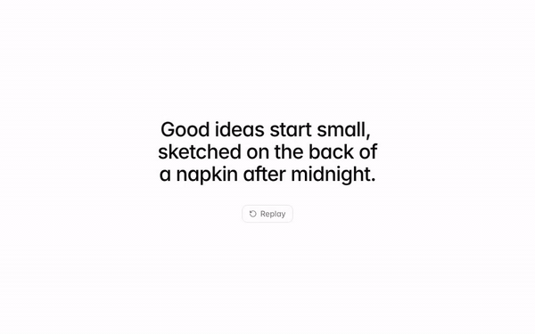</a><br /><a href="https://nextui.dev/components/perspective-text-swap"><b>Perspective text swap</b></a> · <code>perspective-text-swap</code><sub></sub><br /><sub>Replaces one phrase with another in a soft, perspective-driven 3D turn.</sub></td><td width="50%" valign="top"><a href="https://nextui.dev/components/text-highlight">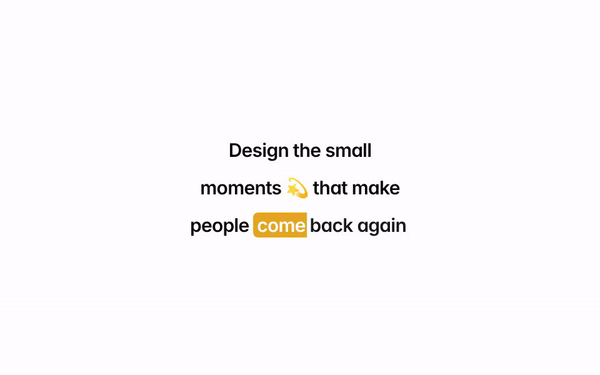</a><br /><a href="https://nextui.dev/components/text-highlight"><b>Text highlight</b></a> · <code>text-highlight</code><sub></sub><br /><sub>An inline marker that sweeps behind a key phrase once it scrolls into view.</sub></td></tr>
<tr><td width="50%" valign="top"><a href="https://nextui.dev/components/flip-text">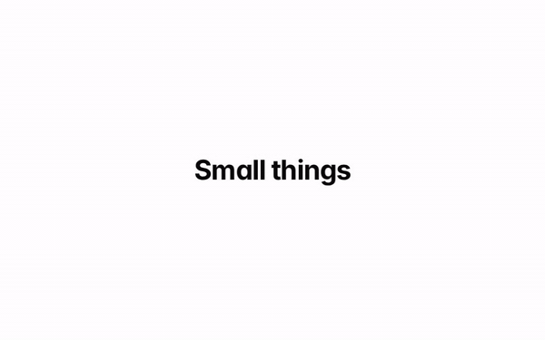</a><br /><a href="https://nextui.dev/components/flip-text"><b>Flip text</b></a> · <code>flip-text</code><sub></sub><br /><sub>Text whose letters roll forward like little cubes, one after another in a wave that loops without a seam.</sub></td></tr>
</table>

## Blocks

<table>
<tr><td width="50%" valign="top"><a href="https://nextui.dev/blocks/hero-pill">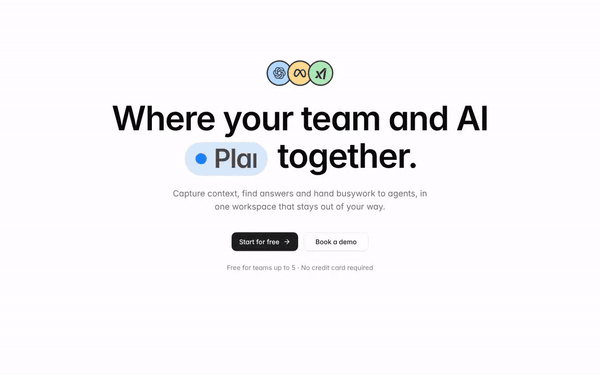</a><br /><a href="https://nextui.dev/blocks/hero-pill"><b>Pill hero</b></a> · <code>hero-pill</code><sub></sub><br /><sub>Centered hero with a crew of bobbing agent avatars and a headline pill that wipes between words and colours. Respects reduced motion.</sub></td><td width="50%" valign="top"><a href="https://nextui.dev/blocks/hero-grid"></a><br /><a href="https://nextui.dev/blocks/hero-grid"><b>Grid hero</b></a> · <code>hero-grid</code><sub> · source in this repo</sub><br /><sub>Centered hero on a square grid where integration icons blink in and out, paused while off screen.</sub></td></tr>
<tr><td width="50%" valign="top"><a href="https://nextui.dev/blocks/moodboard-generator">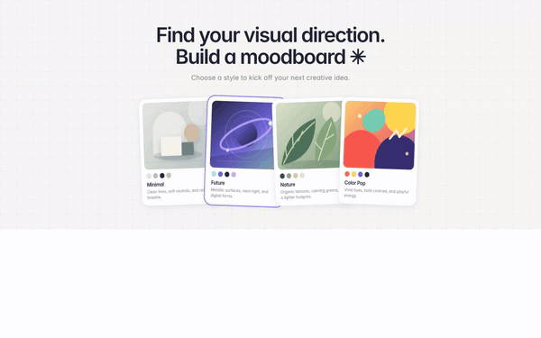</a><br /><a href="https://nextui.dev/blocks/moodboard-generator"><b>Moodboard generator</b></a> · <code>moodboard-generator</code><sub></sub><br /><sub>Choose from four modern visual directions to kick off a creative moodboard.</sub></td><td width="50%" valign="top"><a href="https://nextui.dev/blocks/hero-waitlist"></a><br /><a href="https://nextui.dev/blocks/hero-waitlist"><b>Waitlist hero</b></a> · <code>hero-waitlist</code><sub> · source in this repo</sub><br /><sub>Hero with email capture and avatar social proof.</sub></td></tr>
<tr><td width="50%" valign="top"><a href="https://nextui.dev/blocks/intro-banner">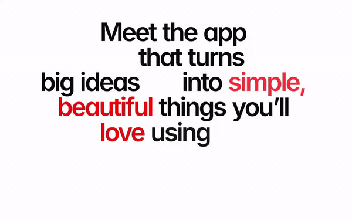</a><br /><a href="https://nextui.dev/blocks/intro-banner"><b>Intro banner</b></a> · <code>intro-banner</code><sub></sub><br /><sub>A playful typographic hero with a staggered word-and-emoji entrance animation.</sub></td><td width="50%" valign="top"><a href="https://nextui.dev/blocks/creative-home-hero">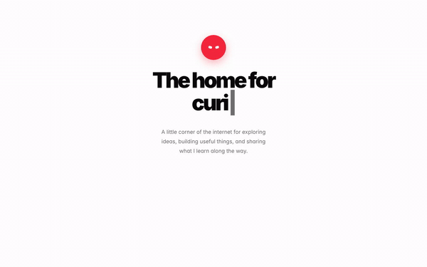</a><br /><a href="https://nextui.dev/blocks/creative-home-hero"><b>Creative home hero</b></a> · <code>creative-home-hero</code><sub></sub><br /><sub>Creator-style homepage hero with an expressive robot and a cycling typewriter headline.</sub></td></tr>
<tr><td width="50%" valign="top"><a href="https://nextui.dev/blocks/hero-chat"></a><br /><a href="https://nextui.dev/blocks/hero-chat"><b>Chat hero</b></a> · <code>hero-chat</code><sub> · source in this repo</sub><br /><sub>AI hero with a polished chatbox whose placeholder types out questions, ringed by app icons orbiting on dashed circles. Paused while off screen.</sub></td><td width="50%" valign="top"><a href="https://nextui.dev/blocks/app-shelf">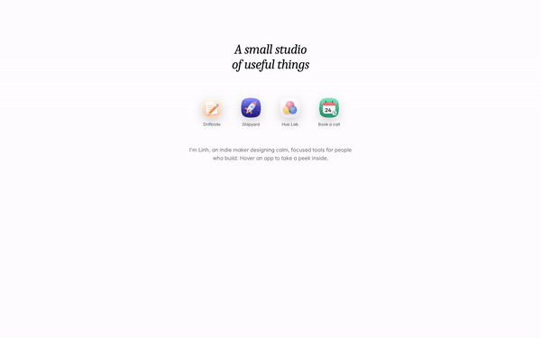</a><br /><a href="https://nextui.dev/blocks/app-shelf"><b>App shelf</b></a> · <code>app-shelf</code><sub></sub><br /><sub>Row of glossy app icons where hovering one bounces a mock preview out of it, with name, blurb and button, while the rest of the page softens into a blur.</sub></td></tr>
<tr><td width="50%" valign="top"><a href="https://nextui.dev/blocks/usage-card">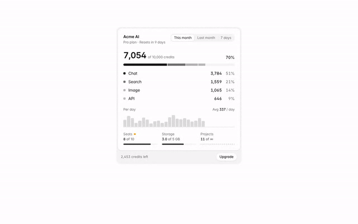</a><br /><a href="https://nextui.dev/blocks/usage-card"><b>Usage card</b></a> · <code>usage-card</code><sub></sub><br /><sub>Animated credit usage card with period tabs, stacked breakdown, daily chart and plan limits.</sub></td><td width="50%" valign="top"><a href="https://nextui.dev/blocks/design-results">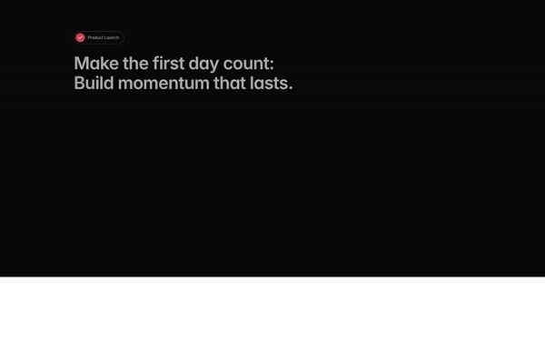</a><br /><a href="https://nextui.dev/blocks/design-results"><b>Design results</b></a> · <code>design-results</code><sub></sub><br /><sub>Dark agency mission and results section with staggered entrance animations and a tilted client satisfaction card.</sub></td></tr>
<tr><td width="50%" valign="top"><a href="https://nextui.dev/blocks/pricing-tiers"></a><br /><a href="https://nextui.dev/blocks/pricing-tiers"><b>Pricing tiers</b></a> · <code>pricing-tiers</code><sub> · source in this repo</sub><br /><sub>Three plans with a monthly/annual toggle, usage chips and a framed recommended tier.</sub></td><td width="50%" valign="top"><a href="https://nextui.dev/blocks/dashboard-home"></a><br /><a href="https://nextui.dev/blocks/dashboard-home"><b>Dashboard home</b></a> · <code>dashboard-home</code><sub> · source in this repo</sub><br /><sub>Dashboard start page with today's counts, an AI search bar, quick actions and revenue and target cards.</sub></td></tr>
<tr><td width="50%" valign="top"><a href="https://nextui.dev/blocks/testimonials"></a><br /><a href="https://nextui.dev/blocks/testimonials"><b>Testimonials</b></a> · <code>testimonials</code><sub> · source in this repo</sub><br /><sub>Three testimonial cards with ratings and avatars.</sub></td><td width="50%" valign="top"><a href="https://nextui.dev/blocks/quote"></a><br /><a href="https://nextui.dev/blocks/quote"><b>Quote</b></a> · <code>quote</code><sub> · source in this repo</sub><br /><sub>One large testimonial with author.</sub></td></tr>
<tr><td width="50%" valign="top"><a href="https://nextui.dev/blocks/team"></a><br /><a href="https://nextui.dev/blocks/team"><b>Team</b></a> · <code>team</code><sub> · source in this repo</sub><br /><sub>Staggered speaker cards on one warm backdrop with a champagne keynote card, scroll-in and hover motion.</sub></td><td width="50%" valign="top"><a href="https://nextui.dev/blocks/leads-table">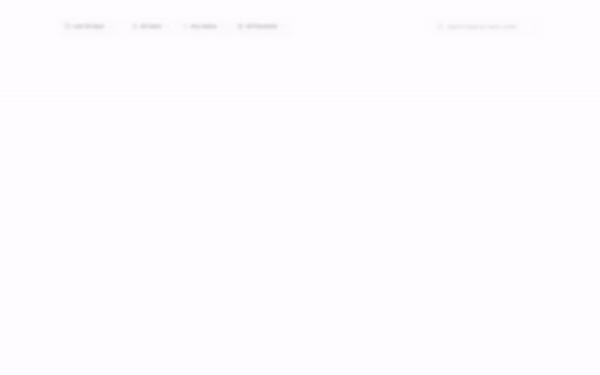</a><br /><a href="https://nextui.dev/blocks/leads-table"><b>Leads table</b></a> · <code>leads-table</code><sub></sub><br /><sub>CRM leads table with click-to-sort columns, filter dropdowns for date, owner, status and payment, search, row selection and pagination. Rows cascade in and deal values count up when it scrolls into view.</sub></td></tr>
<tr><td width="50%" valign="top"><a href="https://nextui.dev/blocks/sign-in">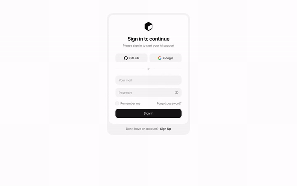</a><br /><a href="https://nextui.dev/blocks/sign-in"><b>Sign in</b></a> · <code>sign-in</code><sub></sub><br /><sub>Sign-in card in a soft frame: GitHub and Google buttons, email and password with a show toggle, remember me and a sign-up footer.</sub></td></tr>
</table>

## Pages

Full pages and landing templates. Open one for a live preview.

| Page | Description | Price |
| --- | --- | --- |
| [ASCII workspace](https://nextui.dev/pages/ascii-workspace) | Full-viewport agent app start screen: sidebar, prompt box and task cards. The pointer uncovers ASCII glyphs that fade toward the edge of its lens; clicking empty space drops a ripple of glyphs that spreads like water. | $49 |
| [CRM overview](https://nextui.dev/pages/crm-overview) | CRM start page: stat cards that count up, a pipeline funnel and lead trend, a live knowledge graph with five layouts (galaxy, cosmos, grid, orbit, radial), to-dos, agent runs and the next 14 days. | Free |
| [Developer portfolio](https://nextui.dev/pages/developer-portfolio) | One-page portfolio for a developer: animated grid hero with a waving avatar, bento cards (experience, live terminal, reading, location, work steps), about, a staggered projects grid with a particle globe, videos, subscribe and a footer with a giant handle. | $49 |
| [Particle landing](https://nextui.dev/pages/particle-landing) | Dark landing page for an AI assistant with a particle cloud that follows the scroll: a meshed sphere rises behind the hero, slides aside, folds into a ring around a chat, flattens into a wave, scatters into stars and gathers back for the closing call to action. | $49 |
| [Particle story](https://nextui.dev/pages/particle-story) | A dark-and-gold atelier landing page where thousands of particles break apart and rebuild into each section's shape on scroll: Saturn, phone, laptop, monitor, globe, network, tablets, dial and crystals, with an editorial header, dot rail and full footer. | $49 |
| [Statement converter](https://nextui.dev/pages/statement-converter) | Deep-green bank-statement-to-CSV LP featuring live PDF parsing demo, scroll manifesto, bank grid, step rows, comparison table, draggable reviews & local clock. | $49 |
| [AI photo studio](https://nextui.dev/pages/ai-photo-studio) | Dark navy/indigo AI photo LP with pink-orange accents & auto-typing brief. Interactive: unblurring takes, handwritten notes, auto-Kanban, seed-lock & code card. Complete with stats, lighting chips, spotlight grid, reviews, pricing & FAQ. | $49 |
| [Group card launch](https://nextui.dev/pages/group-card-launch) | Bright fintech launch-event LP for a shared group card. Motion: 3D card coverflow, chunky multicolour number that drops in with confetti, sticker shapes popping on scroll, live split feed, perk progress meters, flip countdown & share burst. Built from geometric shapes, no illustrations. | $49 |
| [Month-end story](https://nextui.dev/pages/month-end-story) | Scroll-told story LP for an AI month-end close service. Motion: pinned chapters with captions that light up word by word, a memo typing itself out of redaction bars, hours and days ticking up, a busywork bar flipping to judgment, roles stepping forward, a folder unfolding into a live checklist, scattered steps snapping into a pipeline, clock vs seal finale. Built from CSS shapes and icons, no illustrations. | Free |

## What's in this repo

- [`registry/`](registry): MIT-licensed source of 31 items, marked "source in this repo" above
- [`skills/nextui/`](skills/nextui/SKILL.md): the agent skill, with a reference file for each of those items
- [`.github/assets/previews/`](.github/assets/previews): the preview GIFs used in this README

## License

The source in this repository is MIT licensed: use it in personal and commercial projects. Other items are installed from nextui.dev and covered by the [nextui license](https://nextui.dev/license).
