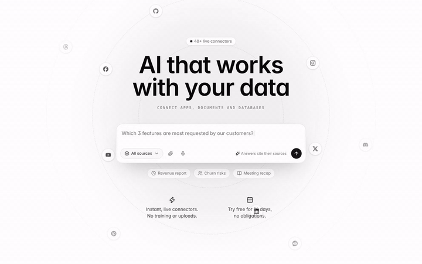
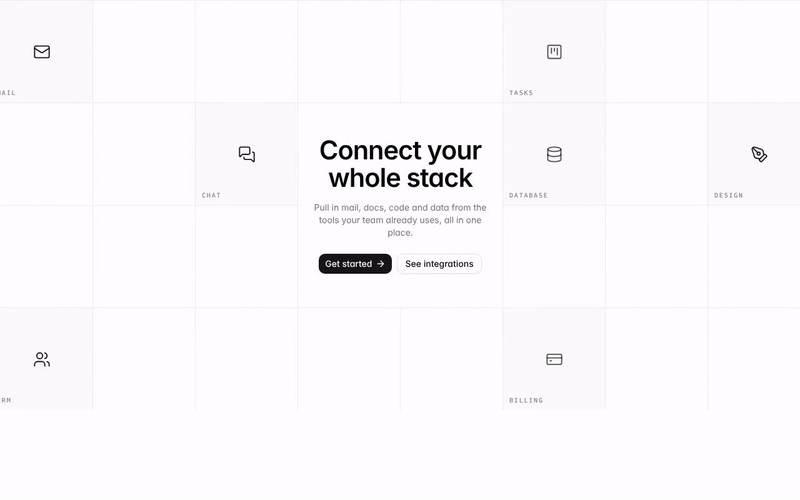
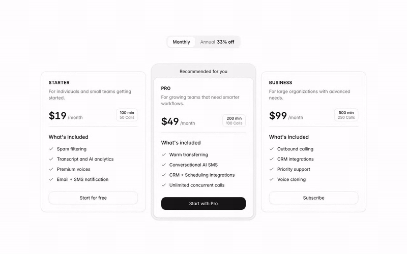
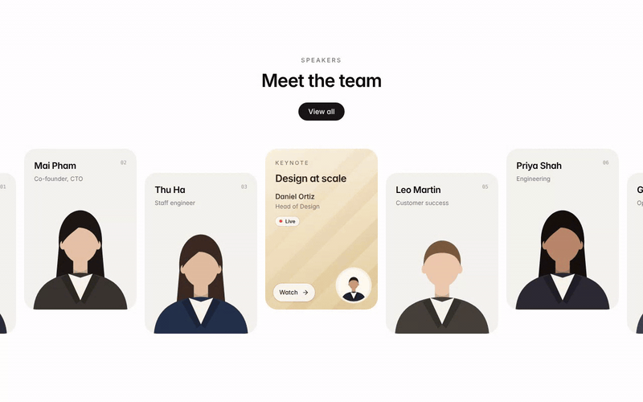
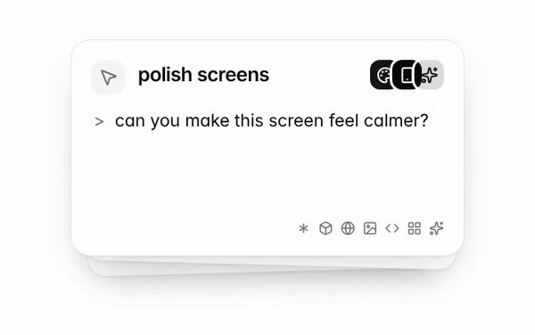
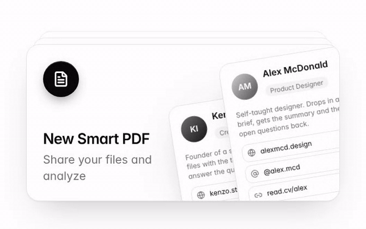
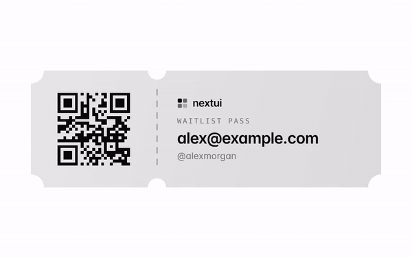
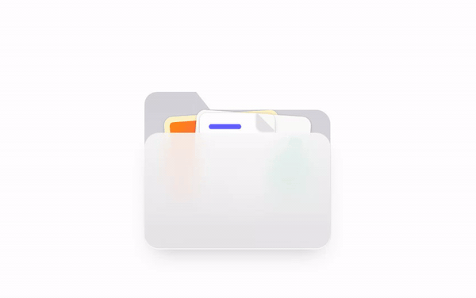
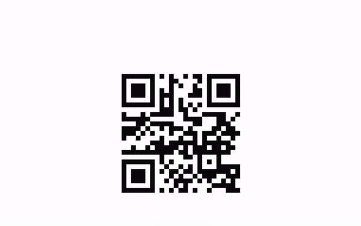
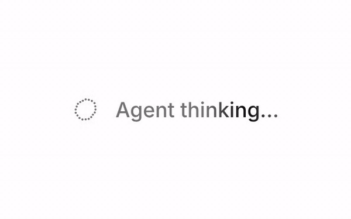

<p align="center">
  <a href="https://nextui.dev">
    <picture>
      <source media="(prefers-color-scheme: dark)" srcset=".github/assets/logo-dark.svg" />
      
    </picture>
  </a>
</p>

<h1 align="center">nextui</h1>

<p align="center">Beautiful, copy-paste React components for shadcn/ui and Tailwind CSS v4,<br />ready for you and for your coding agent.</p>

<p align="center"><a href="https://nextui.dev"><b>Browse the library →</b></a></p>

<table>
<tr><td width="50%" align="center"><a href="https://nextui.dev/blocks/hero-04"></a><br /><sub><b>Orbit chat hero</b> · <code>hero-04</code></sub></td><td width="50%" align="center"><a href="https://nextui.dev/blocks/hero-02"></a><br /><sub><b>Integrations grid hero</b> · <code>hero-02</code></sub></td></tr>
<tr><td width="50%" align="center"><a href="https://nextui.dev/blocks/pricing-01"></a><br /><sub><b>Three-tier pricing</b> · <code>pricing-01</code></sub></td><td width="50%" align="center"><a href="https://nextui.dev/blocks/team-01"></a><br /><sub><b>Team carousel</b> · <code>team-01</code></sub></td></tr>
<tr><td width="50%" align="center"><a href="https://nextui.dev/components/card-05"></a><br /><sub><b>Prompt deck</b> · <code>card-05</code></sub></td><td width="50%" align="center"><a href="https://nextui.dev/components/card-06"></a><br /><sub><b>Smart PDF stack</b> · <code>card-06</code></sub></td></tr>
<tr><td width="50%" align="center"><a href="https://nextui.dev/components/waitlist"></a><br /><sub><b>Waitlist</b> · <code>waitlist</code></sub></td><td width="50%" align="center"><a href="https://nextui.dev/components/tabs-01"></a><br /><sub><b>Waitlist pass</b> · <code>tabs-01</code></sub></td></tr>
<tr><td width="50%" align="center"><a href="https://nextui.dev/components/card-03"></a><br /><sub><b>Folder card</b> · <code>card-03</code></sub></td><td width="50%" align="center"><a href="https://nextui.dev/components/badge-01"></a><br /><sub><b>QR scan badge</b> · <code>badge-01</code></sub></td></tr>
<tr><td width="50%" align="center"><a href="https://nextui.dev/components/card-02"></a><br /><sub><b>Agent thinking</b> · <code>card-02</code></sub></td><td width="50%" align="center"><a href="https://nextui.dev/motion/sound-ring"></a><br /><sub><b>Sound ring</b> · <code>sound-ring</code></sub></td></tr>
</table>

- 30 free components, blocks and motion effects, MIT licensed
- One command to install, no package to depend on: the code lands in your project
- An agent skill, so Claude Code, Cursor, Codex and other agents pick the right component and wire it in

## Install a component

```bash
npx shadcn@latest add https://nextui.dev/r/hero-02.json
```

Every item's page on [nextui.dev](https://nextui.dev) has a live preview and its install command.

## Use it with your coding agent

```bash
npx skills add tini-coder/nextui
```

Then ask for what you want, for example "add a pricing section with a monthly / yearly toggle". The skill lives in [`skills/nextui/`](skills/nextui/SKILL.md).

## What's free

### Components

| Item | Description | Name |
| --- | --- | --- |
| [Agent thinking](https://nextui.dev/components/card-02) | Thinking indicator: a wobbling dot ring and a shimmering label. | `card-02` |
| [Thinking indicator](https://nextui.dev/components/button-03) | AI thinking status with a monochrome sparkling diamond and shimmering text. | `button-03` |
| [Prompt deck](https://nextui.dev/components/card-05) | A stack of prompt cards that swipes the front card away and lifts the next one into place, on a loop while it is on screen. | `card-05` |
| [Input with label](https://nextui.dev/components/input-01) | Email input with a label and helper text. | `input-01` |
| [Input with icon and button](https://nextui.dev/components/input-02) | Newsletter-style input with a leading icon and submit button. | `input-02` |
| [Settings switches](https://nextui.dev/components/switch-01) | Notification settings list with switches. | `switch-01` |
| [Password with strength meter](https://nextui.dev/components/input-03) | Password input with show/hide toggle and a live strength checklist. | `input-03` |
| [One-time code input](https://nextui.dev/components/input-04) | Six-digit OTP input with paste, backspace and arrow-key support. | `input-04` |
| [Waitlist](https://nextui.dev/components/waitlist) | Email signup with a live avatar stack: new people slide in, the last one tucks under a rolling join counter. | `waitlist` |
| [Folder card](https://nextui.dev/components/card-03) | Folder that opens on hover and fans out the files inside. | `card-03` |
| [Smart PDF stack](https://nextui.dev/components/card-06) | A file card with paper sheets and tilted profile cards behind it that rise in on enter and fan out on hover. | `card-06` |
| [Waitlist pass](https://nextui.dev/components/tabs-01) | Ticket-style waitlist pass with notched edges, a QR code stub and a tilt-and-glare hover. | `tabs-01` |
| [Buttons with icons](https://nextui.dev/components/button-01) | Secondary, outline and destructive buttons with soft status buttons and animated icons, popping in as one group. | `button-01` |
| [QR scan badge](https://nextui.dev/components/badge-01) | A QR code that dissolves into sand, pours into a scan badge and grows back. | `badge-01` |
| [Avatar group](https://nextui.dev/components/avatar-01) | Stacked avatars with an overflow count. | `avatar-01` |
| [Rolling price badge](https://nextui.dev/components/badge-02) | Pill badge that rolls between prices glyph by glyph, resizing smoothly as it goes. | `badge-02` |
| [Avatars with status](https://nextui.dev/components/avatar-02) | Team list with online, away and offline status dots. | `avatar-02` |
| [Alert banners](https://nextui.dev/components/alert-01) | Info, success, warning and error alerts with dismiss buttons. | `alert-01` |
| [FAQ accordion](https://nextui.dev/components/accordion-01) | Accessible accordion built on details and summary. | `accordion-01` |
| [Keyboard shortcuts](https://nextui.dev/components/kbd-01) | Shortcut list with styled key caps. | `kbd-01` |
| [Empty state](https://nextui.dev/components/empty-01) | Dashed empty state with a skeleton-card illustration, copy and two actions. | `empty-01` |

### Blocks

| Item | Description | Name |
| --- | --- | --- |
| [Integrations grid hero](https://nextui.dev/blocks/hero-02) | Centered hero on a square grid where integration icons blink in and out, paused while off screen. | `hero-02` |
| [Waitlist hero](https://nextui.dev/blocks/hero-03) | Hero with email capture and avatar social proof. | `hero-03` |
| [Orbit chat hero](https://nextui.dev/blocks/hero-04) | AI hero with a polished chatbox whose placeholder types out questions, ringed by app icons orbiting on dashed circles. Paused while off screen. | `hero-04` |
| [Three-tier pricing](https://nextui.dev/blocks/pricing-01) | Three plans with a monthly/annual toggle, usage chips and a framed recommended tier. | `pricing-01` |
| [Feature with board](https://nextui.dev/blocks/features-03) | Text and checklist next to a kanban-style pipeline mockup. | `features-03` |
| [Testimonial cards](https://nextui.dev/blocks/testimonials-01) | Three testimonial cards with ratings and avatars. | `testimonials-01` |
| [Single quote](https://nextui.dev/blocks/testimonials-02) | One large testimonial with author. | `testimonials-02` |
| [Team carousel](https://nextui.dev/blocks/team-01) | Staggered speaker cards on one warm backdrop with a champagne keynote card, scroll-in and hover motion. | `team-01` |

### Motion

| Item | Description | Name |
| --- | --- | --- |
| [Sound ring](https://nextui.dev/motion/sound-ring) | A ring of rounded bars that jumps like an audio visualizer, each beat lifting a cluster of bars into a peak. | `sound-ring` |

## nextui Pro

Pro adds 9 more items (AI chat input, Agent task checklist, File dropzone, Style marquee card, Celebration card, Animated pill hero, Usage card, Sign-in card, Text reveal) and every new one as it ships. Install them with the same CLI using your access key.

**[See Pro →](https://nextui.dev/pricing)**

## License

The free items in this repository are MIT licensed: use them in personal and commercial projects. Pro items are covered by the [nextui license](https://nextui.dev/pricing) and are not part of this repository.
