<p align="center">
  <a href="https://nextui.dev">
    <picture>
      <source media="(prefers-color-scheme: dark)" srcset=".github/assets/logo-dark.svg" />
      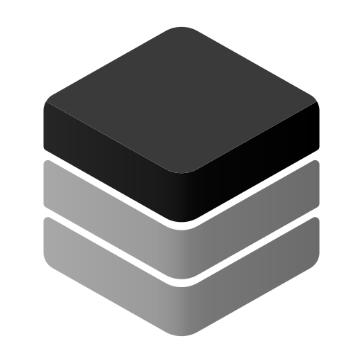
    </picture>
  </a>
</p>

<h1 align="center">nextui</h1>

<p align="center">Beautiful, copy-paste React components for shadcn/ui and Tailwind CSS v4,<br />ready for you and for your coding agent.</p>

<p align="center"><a href="https://nextui.dev"><b>Browse the library →</b></a></p>

- 31 free components, blocks and motion effects, MIT licensed
- One command to install, no package to depend on: the code lands in your project
- An agent skill, so Claude Code, Cursor, Codex and other agents pick the right component and wire it in

## Install a component

```bash
npx shadcn@latest add https://nextui.dev/r/hero-grid.json
```

Every item's page on [nextui.dev](https://nextui.dev) has a live preview and its install command.

## Use it with your coding agent

```bash
npx skills add tini-coder/nextui
```

Then ask for what you want, for example "add a pricing section with a monthly / yearly toggle". The skill lives in [`skills/nextui/`](skills/nextui/SKILL.md).

## What's free

### Components

<table>
<tr><td width="50%" valign="top"><a href="https://nextui.dev/components/thinking-ring">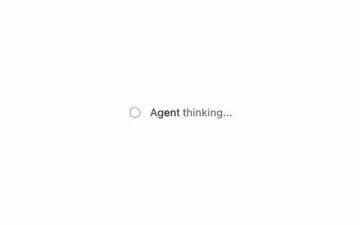</a><br /><a href="https://nextui.dev/components/thinking-ring"><b>Thinking ring</b></a> · <code>thinking-ring</code><br /><sub>Thinking indicator: a wobbling dot ring and a shimmering label.</sub></td><td width="50%" valign="top"><a href="https://nextui.dev/components/thinking-sparkle"></a><br /><a href="https://nextui.dev/components/thinking-sparkle"><b>Thinking sparkle</b></a> · <code>thinking-sparkle</code><br /><sub>AI thinking status with a monochrome sparkling diamond and shimmering text.</sub></td></tr>
<tr><td width="50%" valign="top"><a href="https://nextui.dev/components/thinking-bot">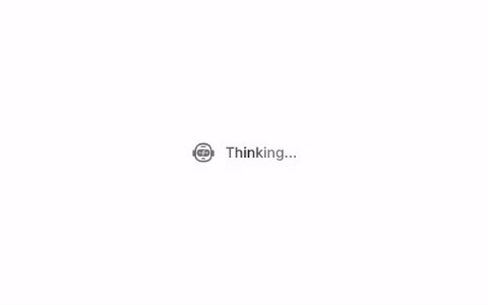</a><br /><a href="https://nextui.dev/components/thinking-bot"><b>Thinking bot</b></a> · <code>thinking-bot</code><br /><sub>AI thinking status with a sleek android helmet whose visor bars bounce like a voice meter beside shimmering text.</sub></td><td width="50%" valign="top"><a href="https://nextui.dev/components/prompt-deck">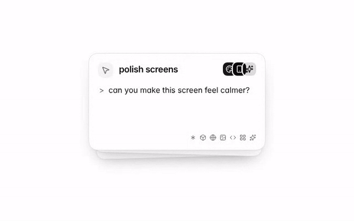</a><br /><a href="https://nextui.dev/components/prompt-deck"><b>Prompt deck</b></a> · <code>prompt-deck</code><br /><sub>A stack of prompt cards that swipes the front card away and lifts the next one into place, on a loop while it is on screen.</sub></td></tr>
<tr><td width="50%" valign="top"><a href="https://nextui.dev/components/labeled-input">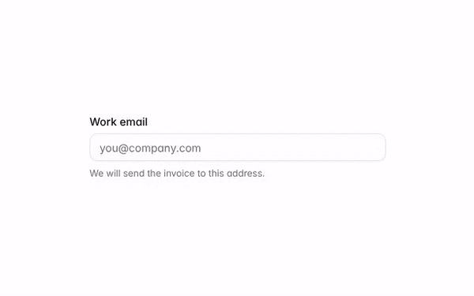</a><br /><a href="https://nextui.dev/components/labeled-input"><b>Labeled input</b></a> · <code>labeled-input</code><br /><sub>Email input with a label and helper text.</sub></td><td width="50%" valign="top"><a href="https://nextui.dev/components/subscribe-input">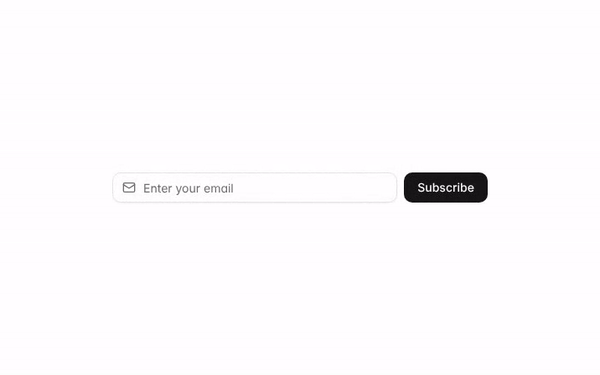</a><br /><a href="https://nextui.dev/components/subscribe-input"><b>Subscribe input</b></a> · <code>subscribe-input</code><br /><sub>Newsletter-style input with a leading icon and submit button.</sub></td></tr>
<tr><td width="50%" valign="top"><a href="https://nextui.dev/components/settings-list">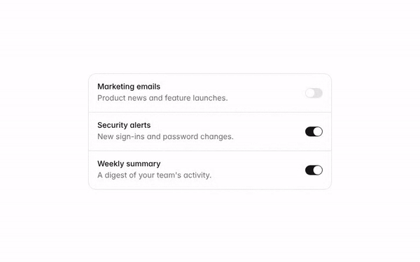</a><br /><a href="https://nextui.dev/components/settings-list"><b>Settings list</b></a> · <code>settings-list</code><br /><sub>Notification settings list with switches.</sub></td><td width="50%" valign="top"><a href="https://nextui.dev/components/password-input">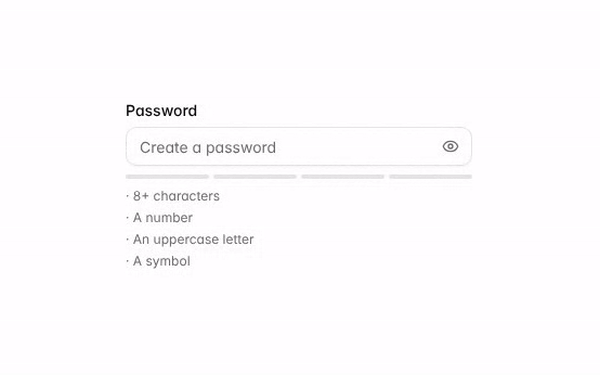</a><br /><a href="https://nextui.dev/components/password-input"><b>Password input</b></a> · <code>password-input</code><br /><sub>Password input with show/hide toggle and a live strength checklist.</sub></td></tr>
<tr><td width="50%" valign="top"><a href="https://nextui.dev/components/otp-input">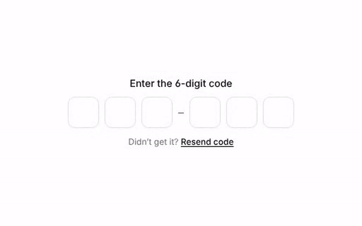</a><br /><a href="https://nextui.dev/components/otp-input"><b>OTP input</b></a> · <code>otp-input</code><br /><sub>Six-digit OTP input with paste, backspace and arrow-key support.</sub></td><td width="50%" valign="top"><a href="https://nextui.dev/components/waitlist">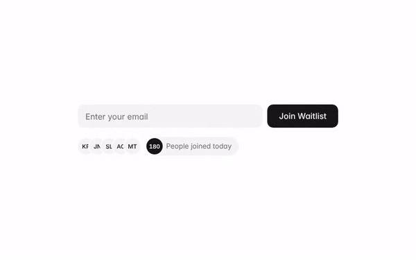</a><br /><a href="https://nextui.dev/components/waitlist"><b>Waitlist</b></a> · <code>waitlist</code><br /><sub>Email signup with a live avatar stack: new people slide in, the last one tucks under a rolling join counter.</sub></td></tr>
<tr><td width="50%" valign="top"><a href="https://nextui.dev/components/folder-card">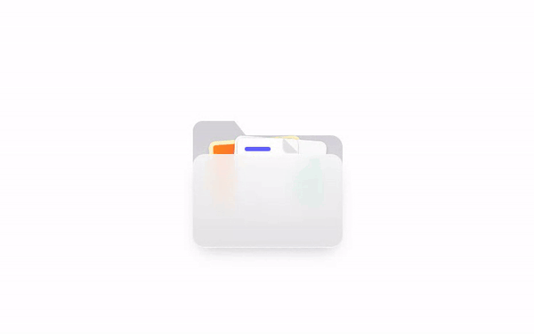</a><br /><a href="https://nextui.dev/components/folder-card"><b>Folder card</b></a> · <code>folder-card</code><br /><sub>Folder that opens on hover and fans out the files inside.</sub></td><td width="50%" valign="top"><a href="https://nextui.dev/components/pdf-stack">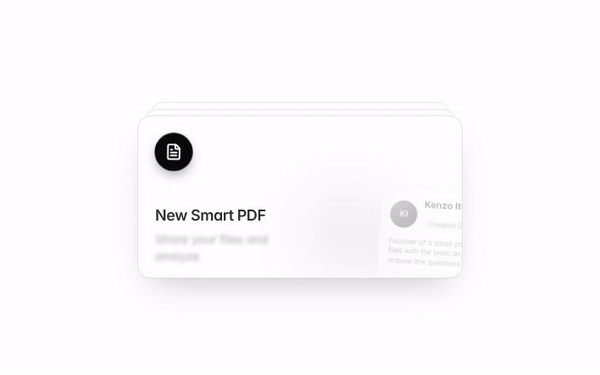</a><br /><a href="https://nextui.dev/components/pdf-stack"><b>PDF stack</b></a> · <code>pdf-stack</code><br /><sub>A file card with paper sheets and tilted profile cards behind it that rise in on enter and fan out on hover.</sub></td></tr>
<tr><td width="50%" valign="top"><a href="https://nextui.dev/components/waitlist-pass">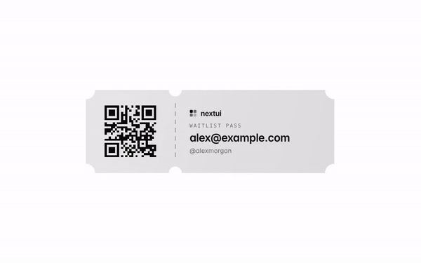</a><br /><a href="https://nextui.dev/components/waitlist-pass"><b>Waitlist pass</b></a> · <code>waitlist-pass</code><br /><sub>Ticket-style waitlist pass with notched edges, a QR code stub and a tilt-and-glare hover.</sub></td><td width="50%" valign="top"><a href="https://nextui.dev/components/icon-buttons">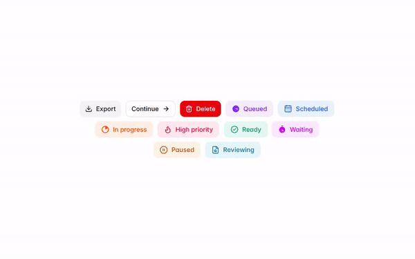</a><br /><a href="https://nextui.dev/components/icon-buttons"><b>Icon buttons</b></a> · <code>icon-buttons</code><br /><sub>Secondary, outline and destructive buttons with soft status buttons and animated icons, popping in as one group.</sub></td></tr>
<tr><td width="50%" valign="top"><a href="https://nextui.dev/components/qr-badge">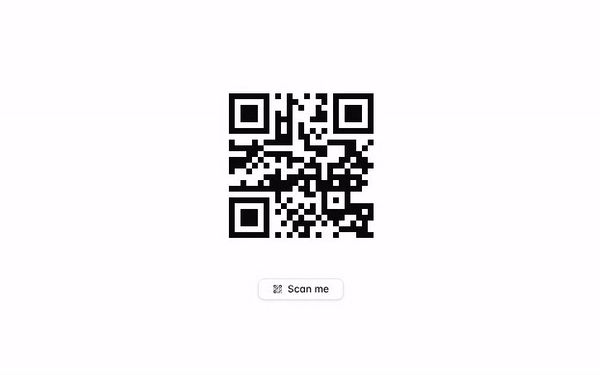</a><br /><a href="https://nextui.dev/components/qr-badge"><b>QR badge</b></a> · <code>qr-badge</code><br /><sub>A QR code that dissolves into sand, pours into a scan badge and grows back.</sub></td><td width="50%" valign="top"><a href="https://nextui.dev/components/avatar-group">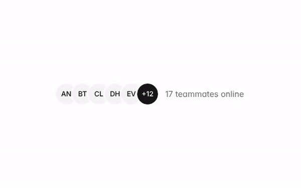</a><br /><a href="https://nextui.dev/components/avatar-group"><b>Avatar group</b></a> · <code>avatar-group</code><br /><sub>Stacked avatars with an overflow count.</sub></td></tr>
<tr><td width="50%" valign="top"><a href="https://nextui.dev/components/price-badge">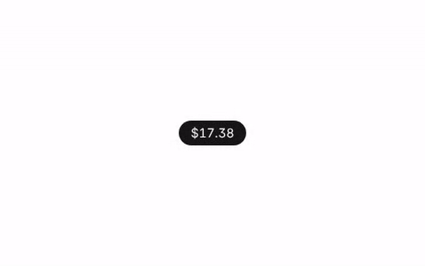</a><br /><a href="https://nextui.dev/components/price-badge"><b>Price badge</b></a> · <code>price-badge</code><br /><sub>Pill badge that rolls between prices glyph by glyph, resizing smoothly as it goes.</sub></td><td width="50%" valign="top"><a href="https://nextui.dev/components/avatar-status">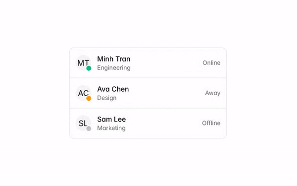</a><br /><a href="https://nextui.dev/components/avatar-status"><b>Avatar status</b></a> · <code>avatar-status</code><br /><sub>Team list with online, away and offline status dots.</sub></td></tr>
<tr><td width="50%" valign="top"><a href="https://nextui.dev/components/alerts">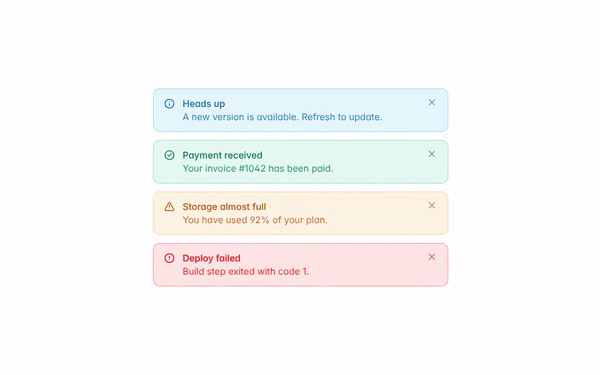</a><br /><a href="https://nextui.dev/components/alerts"><b>Alerts</b></a> · <code>alerts</code><br /><sub>Info, success, warning and error alerts with dismiss buttons.</sub></td><td width="50%" valign="top"><a href="https://nextui.dev/components/faq">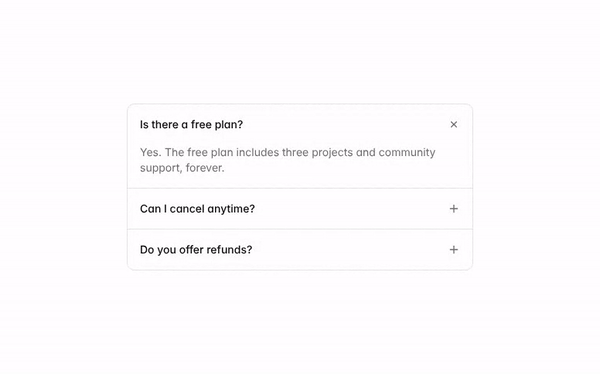</a><br /><a href="https://nextui.dev/components/faq"><b>FAQ</b></a> · <code>faq</code><br /><sub>Accessible accordion built on details and summary.</sub></td></tr>
<tr><td width="50%" valign="top"><a href="https://nextui.dev/components/shortcuts">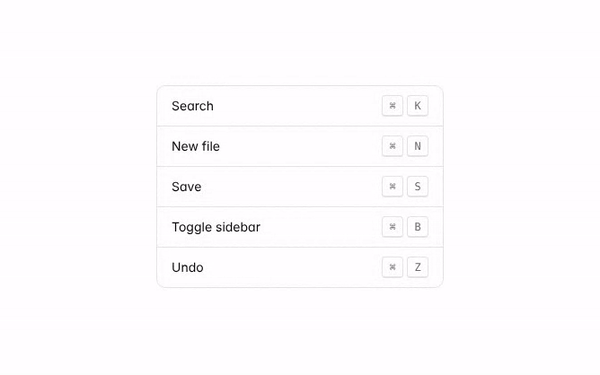</a><br /><a href="https://nextui.dev/components/shortcuts"><b>Shortcuts</b></a> · <code>shortcuts</code><br /><sub>Shortcut list with styled key caps.</sub></td><td width="50%" valign="top"><a href="https://nextui.dev/components/empty-state">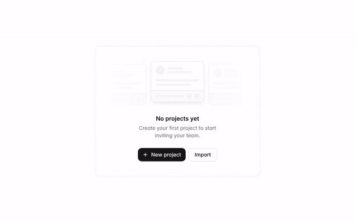</a><br /><a href="https://nextui.dev/components/empty-state"><b>Empty state</b></a> · <code>empty-state</code><br /><sub>Dashed empty state with a skeleton-card illustration, copy and two actions.</sub></td></tr>
</table>

### Blocks

<table>
<tr><td width="50%" valign="top"><a href="https://nextui.dev/blocks/hero-grid">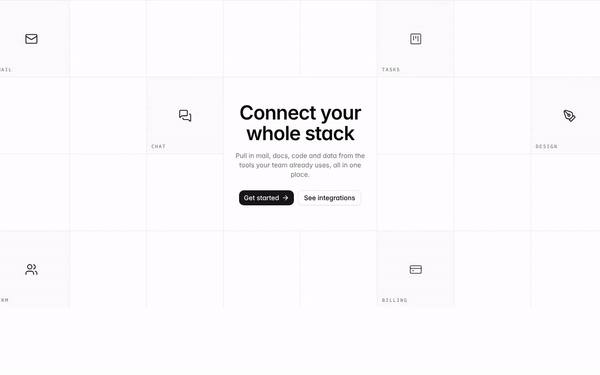</a><br /><a href="https://nextui.dev/blocks/hero-grid"><b>Grid hero</b></a> · <code>hero-grid</code><br /><sub>Centered hero on a square grid where integration icons blink in and out, paused while off screen.</sub></td><td width="50%" valign="top"><a href="https://nextui.dev/blocks/hero-waitlist">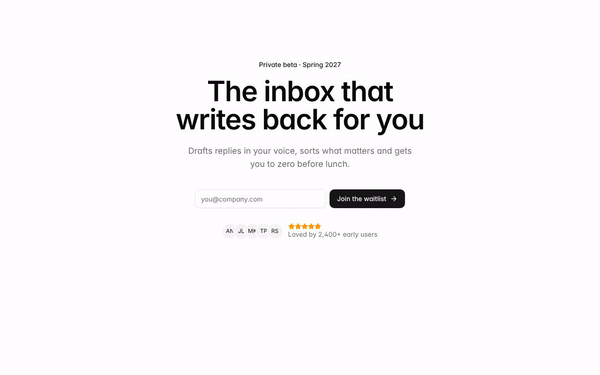</a><br /><a href="https://nextui.dev/blocks/hero-waitlist"><b>Waitlist hero</b></a> · <code>hero-waitlist</code><br /><sub>Hero with email capture and avatar social proof.</sub></td></tr>
<tr><td width="50%" valign="top"><a href="https://nextui.dev/blocks/hero-chat">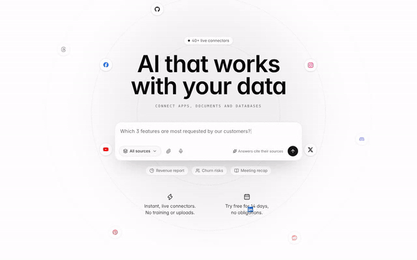</a><br /><a href="https://nextui.dev/blocks/hero-chat"><b>Chat hero</b></a> · <code>hero-chat</code><br /><sub>AI hero with a polished chatbox whose placeholder types out questions, ringed by app icons orbiting on dashed circles. Paused while off screen.</sub></td><td width="50%" valign="top"><a href="https://nextui.dev/blocks/pricing-tiers">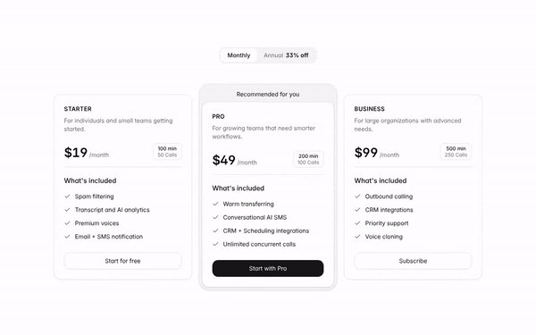</a><br /><a href="https://nextui.dev/blocks/pricing-tiers"><b>Pricing tiers</b></a> · <code>pricing-tiers</code><br /><sub>Three plans with a monthly/annual toggle, usage chips and a framed recommended tier.</sub></td></tr>
<tr><td width="50%" valign="top"><a href="https://nextui.dev/blocks/dashboard-home">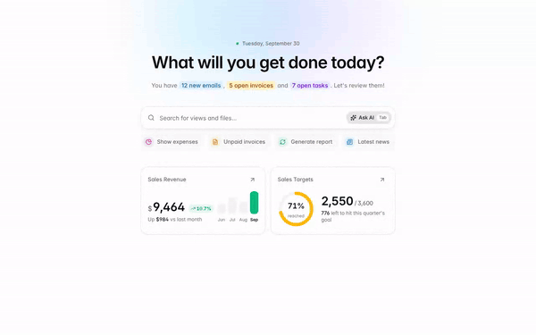</a><br /><a href="https://nextui.dev/blocks/dashboard-home"><b>Dashboard home</b></a> · <code>dashboard-home</code><br /><sub>Dashboard start page with today's counts, an AI search bar, quick actions and revenue and target cards.</sub></td><td width="50%" valign="top"><a href="https://nextui.dev/blocks/testimonials">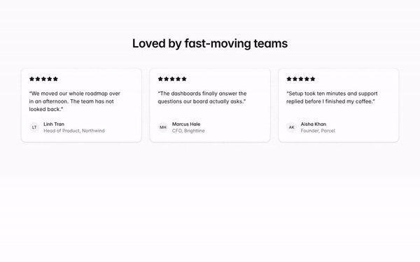</a><br /><a href="https://nextui.dev/blocks/testimonials"><b>Testimonials</b></a> · <code>testimonials</code><br /><sub>Three testimonial cards with ratings and avatars.</sub></td></tr>
<tr><td width="50%" valign="top"><a href="https://nextui.dev/blocks/quote">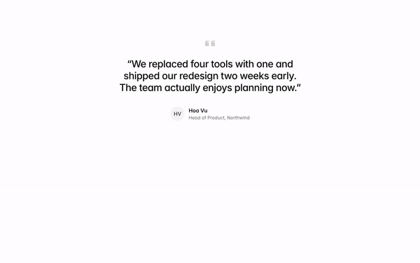</a><br /><a href="https://nextui.dev/blocks/quote"><b>Quote</b></a> · <code>quote</code><br /><sub>One large testimonial with author.</sub></td><td width="50%" valign="top"><a href="https://nextui.dev/blocks/team">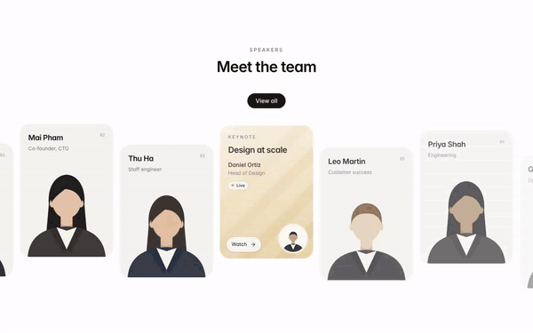</a><br /><a href="https://nextui.dev/blocks/team"><b>Team</b></a> · <code>team</code><br /><sub>Staggered speaker cards on one warm backdrop with a champagne keynote card, scroll-in and hover motion.</sub></td></tr>
</table>

### Motion

<table>
<tr><td width="50%" valign="top"><a href="https://nextui.dev/motion/sound-ring">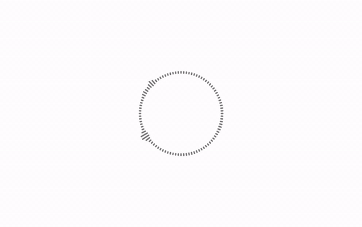</a><br /><a href="https://nextui.dev/motion/sound-ring"><b>Sound ring</b></a> · <code>sound-ring</code><br /><sub>A ring of rounded bars that jumps like an audio visualizer, each beat lifting a cluster of bars into a peak.</sub></td></tr>
</table>

## nextui Pro

Pro adds 9 more items (Chat input, Task checklist, Dropzone, Marquee card, Celebration card, Pill hero, Usage card, Sign in, Text reveal) and every new one as it ships. Install them with the same CLI using your access key.

**[See Pro →](https://nextui.dev/pricing)**

## License

The free items in this repository are MIT licensed: use them in personal and commercial projects. Pro items are covered by the [nextui license](https://nextui.dev/pricing) and are not part of this repository.
